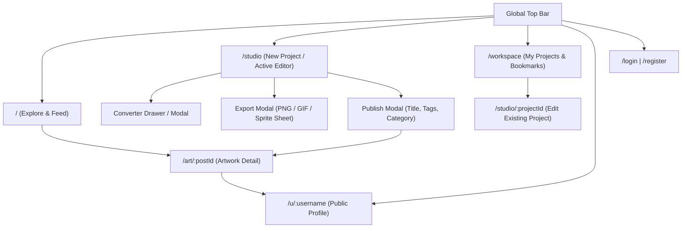
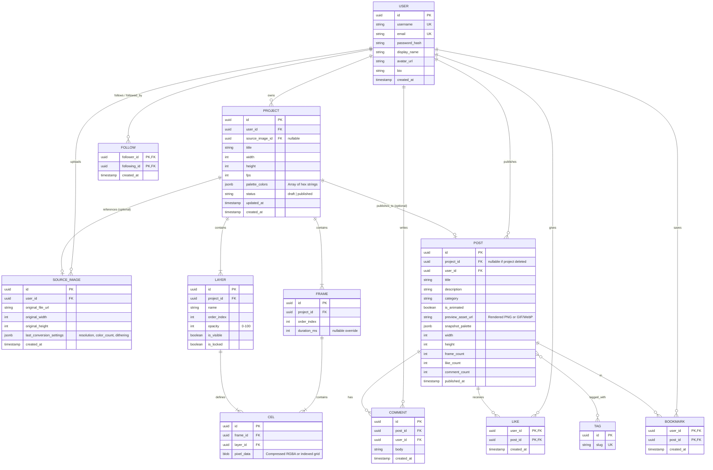

# Product Requirements Document (PRD): Pixaura

## 1. Product Vision and Goals

### Vision
Pixaura is a project-centric pixel art and frame-by-frame animation web application that unifies drawing, image-to-pixel conversion, and animation into a single distraction-free workspace, paired with a gallery-first community for showcasing and discovering work.

### Product Goals
1. **Unified Creative Workflow**: Eliminate context switching by housing static drawing, frame-by-frame animation, and non-destructive image conversion inside a single project structure.
2. **Low Friction, High Control**: Allow guest and registered users to start drawing immediately with intuitive defaults while offering layer management, onion skinning, and custom palettes for experienced artists.
3. **Gallery-First Community**: Focus social features strictly on artwork discovery, appreciation, and creative inspiration rather than chat rooms, forums, or gamified social feeds.

---

## 2. Target Users

| Segment | Description | Core Needs |
| :--- | :--- | :--- |
| **Hobbyist & Beginner Pixel Artists** | Casual creators learning pixel art or making avatars/icons. | Clean UI, preset canvas sizes, image-to-pixel starting points, easy PNG/GIF export. |
| **Indie Game Developers & Animators** | Creators building 2D game sprites, tiles, and frame-by-frame animations. | Layer support, frame timing control, onion skinning, sprite sheet export, custom palettes. |
| **Pixel Art Enthusiasts** | Community members who browse, collect inspiration, and support artists. | Tag/category filtering, clean artwork detail views, bookmarks, and creator following. |

---

## 3. Core Features and Functional Requirements

### 3.1 Pixel Art Editor

- **What it does**: Provides a grid-based raster canvas for creating and editing multi-layer pixel artwork.
- **What users can do**:
  - Create a project from preset dimensions (e.g., 16x16, 32x32, 64x64, 128x128) or custom dimensions.
  - Draw and edit pixels using:
    - **Pencil**: Place single pixels (1px default, configurable brush size 1–8px).
    - **Eraser**: Clear pixels to transparent.
    - **Fill Bucket**: Contiguous (flood fill) or global color replacement on the active layer.
    - **Eyedropper**: Sample color from the active layer or composite canvas.
    - **Shape Tools (Line, Rectangle, Circle)**: Click-and-drag pixel-perfect geometric primitives (outlined or filled) using Bresenham/midpoint algorithms.
  - Manage colors via a active palette: add/remove colors, pick custom hex/RGB/HSL values, and switch between preset palettes.
  - Navigate the canvas via Zoom (100%–6400%), Pan (spacebar + drag or middle-click), Pixel Grid Toggle, and a floating 1x/2x live Mini-Preview window.
  - Manage layers: create, rename, duplicate, delete, reorder, toggle visibility, lock, and adjust layer opacity (0–100%).
  - Undo and Redo actions across drawing and layer operations.
  - Save project state (cloud save for authenticated users; local browser storage fallback for guests).
  - Export static artwork as a PNG at 1x or integer scale multiples (2x, 4x, 8x, 16x) using nearest-neighbor interpolation.
- **Expected behavior**:
  - Drawing operations apply strictly to the currently selected unlocked, visible layer of the active frame.
  - Shape tools render a live preview overlay while dragging and commit pixels on mouse/pointer release.
  - Exporting scales crisp pixel edges without anti-aliasing or blurring.
- **Constraints & Validation Rules**:
  - Canvas width and height: minimum `8px`, maximum `512px` per dimension.
  - Maximum layers per project: `16`.
  - Undo/Redo history stack: minimum `50` sequential actions per session.
  - Palette size limit: `256` colors per project palette.

---

### 3.2 Animation Editor

- **What it does**: Extends the Pixel Art Editor with a collapsible timeline for frame-by-frame animation and playback.
- **What users can do**:
  - Toggle the animation timeline drawer inside the editor without leaving the project.
  - Add blank frames, duplicate existing frames, delete frames, and drag-and-drop to reorder frames.
  - Adjust global playback speed (FPS) and set individual frame duration overrides (in milliseconds or frame holds).
  - Enable **Onion Skinning** to display translucent overlays of previous and next frames (configurable 1–3 frames backward/forward).
  - Play, pause, loop (forward, ping-pong, once), and scrub through frames in real time on the main canvas and in the Mini-Preview window.
  - Export animations as an animated **GIF** or a **PNG Sprite Sheet** (horizontal strip, vertical strip, or grid layout).
- **Expected behavior**:
  - Layers are consistent across frames (structural changes like layer order/visibility apply globally, while pixel cel content is specific to each `[Frame, Layer]` pair).
  - When a single-frame project adds a second frame, the project automatically transitions into an animated project capability without data loss.
- **Constraints & Validation Rules**:
  - Maximum frames per project: `64` frames.
  - Global FPS range: `1` to `30` FPS.
  - Individual frame duration: `20ms` to `5000ms`.
  - Delete Frame is disabled when only `1` frame remains in the project.

---

### 3.3 Image-to-Pixel Art Converter

- **What it does**: Converts uploaded raster images into quantized, downscaled pixel art that can be edited as a standard project layer.
- **What users can do**:
  - Upload a source image (`PNG`, `JPG`, `WebP`) via file picker or drag-and-drop.
  - Crop or fit the source image to target pixel dimensions (maintaining aspect ratio or custom crop).
  - Configure conversion parameters:
    - **Target Resolution**: Output width/height in pixels.
    - **Color Count & Palette**: Quantize colors automatically (2 to 64 colors) or map colors to an existing preset/project palette.
    - **Pixelation Intensity / Dithering**: Adjust pixelation block size and toggle dithering (None, Ordered/Bayer, Floyd-Steinberg).
  - Inspect a side-by-side or split-slider live preview (Original vs. Converted).
  - Import the converted result either as a **new project** or as a **new layer** in the currently open project.
  - View or toggle the preserved original reference image inside the project as a non-editable reference overlay or re-run conversion with different settings later.
- **Expected behavior**:
  - Adjusting conversion sliders recalculates the preview non-destructively from the stored original asset.
  - Importing into the editor extracts the quantized colors and adds them to the project palette automatically.
- **Constraints & Validation Rules**:
  - Supported upload formats: `image/png`, `image/jpeg`, `image/webp`.
  - Maximum source file size: `10 MB`.
  - Maximum source image dimensions: `4096 x 4096 px`.
  - Output pixel dimensions must conform to editor limits (`8x8` to `512x512`).

---

### 3.4 Community & Discovery

- **What it does**: Enables creators to publish finished projects to a public gallery and interact with other creators' work.
- **What users can do**:
  - Publish a saved project with a Title, Description, Tags (up to 5), and Category selection.
  - Browse the Explore feed sorted by **Trending**, **Recent**, or **Following** (for logged-in users).
  - Filter and search posts by keyword, category, tags, and format (`All`, `Static Art`, `Animations`).
  - Open the **Artwork Detail Page** to view the creation at crisp scale, inspect frame playback/speed (for animations), view color palette swatches, and see creator details.
  - Like, Bookmark, and post text Comments on published artworks.
  - Follow and unfollow other creators.
- **Expected behavior**:
  - Publishing creates a snapshot (published post) linked to the underlying project. Subsequent draft edits in the editor do not alter the public post until the creator explicitly clicks "Update Published Post".
  - Animated posts auto-play smoothly in feed cards (on hover or viewport entry) and on the detail page.
- **Constraints & Validation Rules**:
  - Only authenticated users with verified accounts can publish, like, comment, bookmark, or follow.
  - Post Title: required, `3–80` characters.
  - Post Description: optional, max `1,000` characters.
  - Tags: max `5` tags per post; each tag `2–24` alphanumeric/hyphen characters.
  - Comments: `1–500` characters, plain text only (no HTML/markdown injection), rate-limited to `5` comments per minute per user.

---

### 3.5 User and Project Management

- **What it does**: Manages user authentication, personal project workspaces, draft lifecycle, and public creator profiles.
- **What users can do**:
  - Register, log in, reset password, and log out.
  - Access a personal **Workspace Dashboard** listing all Drafts, Published Projects, Saved Source Images, and Bookmarked community posts.
  - Duplicate, rename, or delete personal projects.
  - Edit metadata of published posts, unpublish (revert to private draft), or permanently delete published posts.
  - Customize their **Public Profile** (display name, avatar, short bio) displaying their published creations and follower/following counts.
- **Expected behavior**:
  - Deleting a project that has an associated published post prompts the user to confirm whether to also delete the public post or keep the published snapshot while removing the editable workspace project.
  - If a guest user creates artwork in the editor and then registers/logs in, their active local session project is automatically migrated to their cloud workspace.
- **Constraints & Validation Rules**:
  - Username: unique, `3–24` characters (`a-z`, `0-9`, `_`, `-`).
  - Bio: max `160` characters.
  - Maximum saved draft projects per free user account: `50`.

---

## 4. Main Pages and Screen Descriptions

| Screen | Purpose & Layout |
| :--- | :--- |
| **1. Landing / Explore Page (`/`)** | Public entry point. Top navigation bar, hero CTA ("Start Drawing" / "Convert Image"), filter bar (Categories, Tags, Format: All / Static / Animation, Sort: Trending / Recent), and responsive masonry/grid of artwork cards. |
| **2. Unified Studio Editor (`/studio` & `/studio/:projectId`)** | Full-viewport, distraction-free workspace: - **Top Bar**: Project title, Canvas/Converter mode switch, Undo/Redo, Zoom level, Save status, Export button, Publish button. - **Left Dock**: Drawing tools & tool options (brush size, fill mode, shape fill toggle). - **Center Viewport**: Checkerboard transparency canvas with pan/zoom. - **Right Dock**: Mini-Preview window, Color Palette panel, and Layers panel. - **Bottom Drawer (Collapsible)**: Animation timeline, frame thumbnails, FPS & onion-skin controls. |
| **3. Image Converter Modal / View (`/studio?mode=convert`)** | Integrated overlay inside the Studio. Left side: upload dropzone and original image cropper. Right side: live pixel-art preview and parameter controls (Resolution, Palette/Color count, Dithering). Action buttons: "Create New Project" or "Insert as Layer". |
| **4. Artwork Detail Page (`/art/:postId`)** | Centered showcase stage with integer-scaled crisp rendering, playback controls (for animations), extracted color palette bar, creator card with Follow button, Like/Bookmark counters, tags, and chronological comment section below. |
| **5. Personal Workspace (`/workspace`)** | Authenticated user dashboard with tabs: - **Projects**: All editable projects (filterable by All, Drafts, Published). - **Reference Assets**: Uploaded original images used in conversions. - **Bookmarks**: Community posts saved for inspiration. |
| **6. Creator Profile Page (`/u/:username`)** | Public profile header (Avatar, Display Name, `@username`, Bio, Follower/Following counts, Follow CTA) and a grid of the creator's published pixel art and animations. |
| **7. Auth & Settings (`/login`, `/register`, `/settings`)** | Clean forms for authentication and account management (profile info, password change, account deletion). |

---

## 5. Navigation Structure

- **Global Header** (present on all non-editor pages): Logo/Explore link, Search bar, Primary CTA (`+ Create`), Workspace link, and User Avatar menu.
- **Studio Header** (compact mode): Collapses global navigation into a minimal home menu icon so 90%+ of screen real estate belongs to the canvas, palettes, layers, and timeline.

---

## 6. Main User Flows

### Flow 1: New User Creating Their First Pixel Art
1. User lands on `/` and clicks **Start Drawing** (no login required).
2. Studio (`/studio`) opens with the **New Project Dialog** defaulting to `32x32 px` and a curated starter palette.
3. User selects tools (Pencil, Fill, Line), draws on Layer 1, and adds a second layer for background details.
4. User clicks **Export**, selects `PNG (8x scale)`, and downloads the file immediately, or clicks **Save** which prompts registration/login and migrates the canvas into their new cloud workspace.

### Flow 2: Importing an Image and Converting It into Pixel Art
1. From the Studio or Home page, user clicks **Convert Image**.
2. User uploads a `JPG/PNG/WebP` photo.
3. The Converter stores the original file separately and displays a side-by-side preview at `64x64 px` with `16` colors.
4. User adjusts resolution to `96x96 px`, sets color count to `24`, toggles Bayer dithering, and previews the result in real time.
5. User clicks **Import to Editor**.
6. A project opens with the converted pixel data placed on an editable layer, the extracted 24-color palette loaded in the Palette panel, and the original image linked as a toggleable reference layer.

### Flow 3: Creating and Exporting an Animation
1. Inside the Studio, user opens the bottom **Timeline Drawer** and clicks **Duplicate Frame** on Frame 1.
2. User enables **Onion Skinning** (showing Frame 1 at 30% opacity) and modifies the character's pose on Frame 2.
3. User repeats to create 6 frames, sets global playback to `8 FPS`, and sets Frame 6 duration override to `250ms`.
4. User previews the loop in the Mini-Preview window.
5. User clicks **Export**, chooses **GIF** (or **Sprite Sheet -> Horizontal Strip**), selects `4x` scale, and downloads the output.

### Flow 4: Saving a Project and Continuing Later
1. Authenticated user works on a multi-layer animation in `/studio/:projectId`.
2. Changes auto-save every 30 seconds (or manually via `Ctrl/Cmd + S`), persisting all layers, frames, palette colors, and linked reference images.
3. User closes the browser, returns later, navigates to `/workspace`, and clicks the project card.
4. Studio restores the exact canvas dimensions, layers, frame cels, timeline durations, and custom palette.

### Flow 5: Publishing Artwork and Receiving Community Feedback
1. Inside the Studio, user clicks **Publish**.
2. In the Publish Modal, user enters Title, Description, Category (e.g., `Game Assets`, `Characters`, `Scenery`), and up to 5 Tags.
3. System generates the rendered static PNG or animated media snapshot and creates a public post at `/art/:postId`.
4. Other authenticated users view the post in `/`, click **Like**, leave a **Comment**, or **Bookmark** it.
5. The creator views engagement metrics and comments on `/art/:postId` and can edit metadata or push an updated project snapshot at any time.

### Flow 6: Discovering and Interacting with Other Creators
1. User browses `/` and filters by `Animations` + tag `#cyberpunk`, sorted by `Trending`.
2. User clicks an artwork card to open `/art/:postId`, inspects the frames and palette swatches, and clicks the creator's username.
3. On `/u/:username`, user views the creator's portfolio and clicks **Follow**.
4. New posts from that creator now appear in the user's **Following** feed tab on `/`.

---

## 7. Data Entities and Relationships

---

## 8. Functional Requirements and Business Rules

1. **Non-Destructive Source Image Preservation**:
   - When an image is uploaded to the Image-to-Pixel Converter, the raw file is stored as a `SOURCE_IMAGE` record independent of the converted pixel layer (`CEL`).
   - Deleting or editing the converted pixel layer inside a `PROJECT` must never overwrite or mutate the stored `SOURCE_IMAGE`.
2. **Draft vs. Published Isolation**:
   - A `PROJECT` represents the live editable workspace state (layers, frames, cels).
   - A `POST` represents a flattened, public snapshot (`preview_asset_url` + metadata).
   - Saving changes in a `PROJECT` updates only the draft workspace. The public `POST` is only updated when the owner triggers **Update Published Post**.
3. **Guest-to-Registered Session Migration**:
   - Unauthenticated users can use the Studio Editor, Animation Timeline, Image Converter (in-memory/local storage), and local Export (PNG/GIF/Sprite Sheet).
   - Cloud saving, publishing, liking, commenting, bookmarking, and following require authentication.
   - Upon login or registration from the Studio, the active local project is automatically saved to the user's cloud workspace.
4. **Pixel Integrity Rule**:
   - All canvas viewports, feed thumbnails, and detail page renders must enforce crisp integer or nearest-neighbor scaling (`image-rendering: pixelated`) so artwork never appears blurry.
5. **Ownership & Access Control**:
   - Only the project owner (`PROJECT.user_id`) may view, edit, or delete a draft project or its linked `SOURCE_IMAGE`.
   - Any visitor (guest or authenticated) can view public profiles, explore feeds, and artwork detail pages.
   - Only the post owner (`POST.user_id`) or a system administrator can edit or delete a `POST`, and either the comment author (`COMMENT.user_id`) or the post owner (`POST.user_id`) can delete a `COMMENT`.
6. **Idempotent Social Actions**:
   - A user can Like a post, Bookmark a post, or Follow a creator at most once (`UNIQUE` composite keys). Repeating the action toggles it off. Users cannot follow themselves.

---

## 9. MVP Scope vs. Future Enhancements

### MVP Scope (Must-Have for Launch)
- **Pixel Art Editor**: Configurable canvas (`8x8`–`512x512`), 7 core tools (Pencil, Eraser, Fill Bucket, Eyedropper, Line, Rectangle, Circle), custom color picker & palette management, zoom/pan/grid/mini-preview, 50-step undo/redo, full layer management (up to 16 layers), cloud save + local guest draft, PNG export (1x, 2x, 4x, 8x, 16x).
- **Animation Editor**: Frame timeline (up to 64 frames), add/duplicate/delete/reorder frames, per-frame duration & global FPS (`1–30`), 1-frame forward/backward onion skinning, live playback, GIF and horizontal/grid PNG sprite sheet export.
- **Image-to-Pixel Converter**: PNG/JPG/WebP upload (up to 10MB), target pixel resolution control, color count quantization (`2–64` colors) & palette mapping, pixelation/dithering toggle, live side-by-side preview, direct import into editor, separate preservation of original source image.
- **Community**: Public creator profiles, publish workflow (title, description, category, tags), Explore feed (Trending, Recent, Following), search & filter by tag/category/format, Artwork Detail Page, Likes, Comments, Bookmarks, and Creator Follow system.
- **User & Project Management**: Email/password + OAuth authentication, personal Workspace Dashboard (Drafts, Published, Reference Assets, Bookmarks), edit/unpublish/delete published posts.

### Future Enhancements (Post-MVP / Out of Scope for v1)
- **Advanced Drawing Tools**: Selection tools (rectangular/lasso marquee, move, flip, rotate), symmetry/mirror drawing modes, tilemap/seamless tiling mode, dithering brushes, and gradient tools.
- **Collaboration & Remixing**: Opt-in "Allow Remix" flag letting other users fork a published artwork into their own workspace with attribution, or real-time multi-user canvas sessions.
- **Community Challenges & Collections**: Weekly themed pixel art prompts/palettes and user-curated public collections/galleries.
- **Advanced Export Formats**: Aseprite (`.aseprite`) import/export, WebM/MP4 video export, and CSS box-shadow export.
- **Notifications**: In-app notification bell for new likes, comments, and followers.
