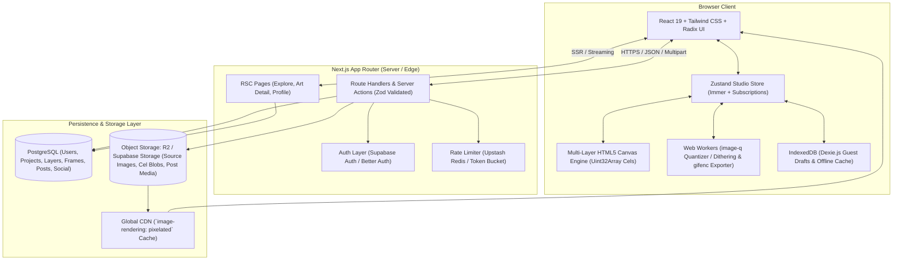
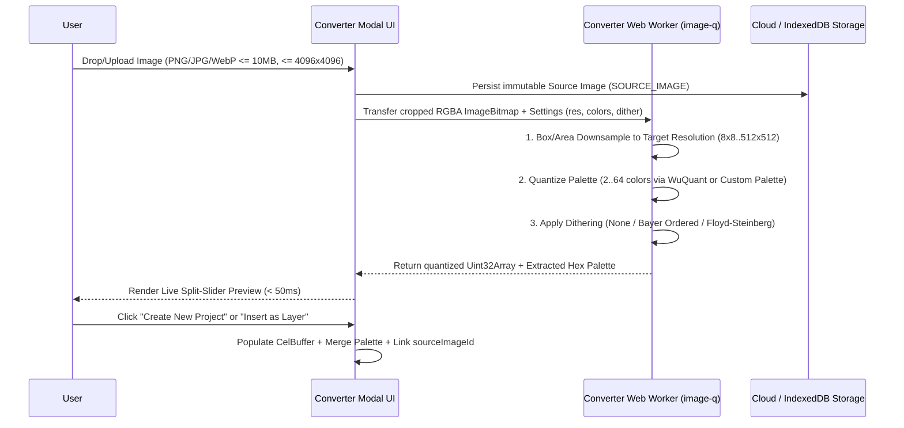

# Technical Specification & Architecture Document: Pixaura

## 1. System Architecture Overview

Pixaura is architected as a **hybrid web application** combining two distinct execution profiles:
1. **The Creative Studio (`/studio`)**: A compute-intensive, low-latency client-side application powered by an HTML5 2D `<canvas>` rendering engine, typed-array (`Uint32Array`) memory buffers, Web Workers for image quantization and GIF encoding, and IndexedDB for offline/guest resilience.
2. **The Community & Workspace Platform (`/`, `/art/:postId`, `/workspace`, `/u/:username`)**: A server-rendered and edge-cached web platform powered by **Next.js (App Router)**, **PostgreSQL**, and **Object Storage** for fast discovery, SEO, and social interactions.



---

## 2. Technology Stack

| Category | Technology | Version / Choice | Rationale |
| :--- | :--- | :--- | :--- |
| **Application Framework** | **Next.js (App Router)** | `15.x` (React `19.x`) | Combines SSR/ISR for public gallery routes (`/`, `/art/[postId]`, `/u/[username]`) with a dedicated client-only boundary (`"use client"`) for `/studio`. |
| **Language** | **TypeScript** | `5.x` (Strict Mode) | Enforces type safety across binary buffer manipulations, worker message protocols, and database schemas. |
| **Styling & UI Primitives** | **Tailwind CSS** + **Radix UI** | Tailwind `4.x` | Zero-runtime CSS with accessible headless primitives for color popovers, dialogs, sliders, tooltips, and context menus. |
| **State Management** | **Zustand** + **Immer** | `5.x` | Decouples high-frequency pointer drawing loops from React re-renders; supports transient subscriptions for canvas redraws. |
| **Drag & Drop** | **`@dnd-kit/core` & `@dnd-kit/sortable`** | `6.x` | Accessible drag-and-drop for reordering animation frames (horizontal) and layers (vertical). |
| **Canvas & Pixel Math** | **Native HTML5 2D Canvas + `Uint32Array`** | Browser Native | Direct pixel manipulation in RGBA32 typed arrays (`ImageData`) guarantees 60fps even on `512×512` 16-layer canvases. |
| **Image Quantization** | **`image-q`** (in Web Worker) | `4.x` | Supports Wu/NeuQuant color quantization (`2–64` colors), custom palette mapping, and Ordered (Bayer) + Floyd-Steinberg dithering. |
| **GIF & PNG Encoding** | **`gifenc`** + **`upng-js`** | `1.x` / `2.x` | Fast client-side animated GIF encoding (with transparency & per-frame delays) and lossless PNG / sprite sheet generation. |
| **Client Persistence** | **IndexedDB via `Dexie.js`** | `4.x` | Stores large binary pixel arrays and 10MB reference images for guest sessions (`localStorage` 5MB quota is insufficient). |
| **Database & ORM** | **PostgreSQL** + **Drizzle ORM** | PG `16` | Relational integrity for `[Project -> Frame/Layer -> Cel]` and social graphs (`Likes`, `Bookmarks`, `Follows`), with type-safe SQL queries. |
| **Authentication** | **Supabase Auth** or **Better Auth** | Latest | Email/password + OAuth (GitHub, Google, Discord) with session cookies and seamless guest-to-user migration hooks. |
| **Object Storage** | **Cloudflare R2** or **Supabase Storage** | S3-compatible | Stores immutable `SOURCE_IMAGE` files, compressed project `CEL` blobs, and rendered `POST` preview assets (`.png`, `.gif`, `.webp`). |
| **Validation & Security** | **Zod** | `3.x` | Shared runtime validation schemas across client forms, API payloads, and environment variables. |

---

## 3. Repository & Directory Structure

```text
pixaura/
├── public/                        # Static assets, preset palettes, icons
├── spec/                          # Product and Technical Documentation
│   ├── PRD.md
│   ├── PRD.html
│   └── TECHNICAL_SPEC.md
├── src/
│   ├── app/                       # Next.js App Router
│   │   ├── (public)/              # Public routes with Global Top Bar
│   │   │   ├── page.tsx           # / (Explore & Feed)
│   │   │   ├── art/[postId]/      # Artwork Detail Page
│   │   │   └── u/[username]/      # Public Creator Profile
│   │   ├── (auth)/                # /login, /register, /settings
│   │   ├── workspace/             # /workspace (Authenticated User Dashboard)
│   │   ├── studio/                # Distraction-free Studio Layout
│   │   │   ├── page.tsx           # /studio (Guest / New Project)
│   │   │   └── [projectId]/       # /studio/:projectId (Cloud Project)
│   │   └── api/                   # REST / RPC Route Handlers
│   │       ├── projects/
│   │       ├── posts/
│   │       ├── converter/
│   │       └── upload/
│   ├── components/
│   │   ├── ui/                    # Shared buttons, modals, sliders, chips
│   │   ├── gallery/               # ArtCard, FilterBar, CommentList, PaletteBar
│   │   └── studio/                # ToolDock, CanvasViewport, LayerPanel, TimelineDrawer, ConverterModal
│   ├── engine/                    # Pure TS Studio Engine (Framework-agnostic)
│   │   ├── canvas/                # Multi-layer renderer, viewport transform, zoom/pan
│   │   ├── tools/                 # Pencil, Eraser, FloodFill, Eyedropper, Bresenham Line/Rect/Circle
│   │   ├── history/               # Command-pattern Undo/Redo patch manager (50+ steps)
│   │   ├── animation/             # Frame scheduler, Onion Skin compositor, playback loop
│   │   ├── exporter/              # PNG integer scaler, Sprite Sheet packer, GIF encoder
│   │   └── workers/               # Web Workers for image-q conversion & GIF export
│   ├── store/                     # Zustand stores
│   │   ├── useStudioStore.ts      # Active project, tool settings, viewport, history
│   │   └── useTimelineStore.ts    # Active frame, playback state, FPS, onion skin settings
│   ├── db/                        # Database & Persistence
│   │   ├── schema.ts              # Drizzle ORM PostgreSQL schema
│   │   ├── migrations/            # SQL migrations
│   │   └── local/                 # Dexie.js IndexedDB schema for guest sessions
│   └── lib/                       # Shared utilities, Zod schemas, auth helpers, storage clients
└── tests/                         # Vitest unit tests & Playwright E2E tests
```

---

## 4. Studio Engine & Canvas Architecture

### 4.1 Why Not DOM Grids?
A DOM-based grid (creating `<div>` nodes per pixel) works at `32×32` (1,024 nodes) but fails at the PRD maximum of `512×512` (**262,144 DOM nodes per layer**). Pixaura uses an **HTML5 `<canvas>` multi-plane architecture** backed by raw `Uint32Array` memory buffers.

### 4.2 Multi-Canvas Viewport Stack
The center viewport stacks 4 synchronized `<canvas>` elements positioned absolutely inside a hardware-accelerated transform container:

```text
+-------------------------------------------------------------------+
|  4. Interaction & Overlay Canvas (Screen Resolution)              |
|     - Pixel grid lines (when zoom >= 800%), brush cursor outline   |
|     - Live uncommitted shape preview (Line, Rect, Circle)         |
+-------------------------------------------------------------------+
|  3. Composite Artwork Canvas (Project Width × Height)             |
|     - Composited visible layers of the active frame               |
|     - Styled with CSS `image-rendering: pixelated`                |
+-------------------------------------------------------------------+
|  2. Onion Skin Canvas (Project Width × Height)                    |
|     - Translucent tint of previous (red/blue) & next frames       |
+-------------------------------------------------------------------+
|  1. Checkerboard Background Canvas (Project Width × Height)       |
|     - Static repeating pattern indicating alpha transparency      |
+-------------------------------------------------------------------+
```

### 4.3 Cel Memory Model (`[Frame, Layer]` Matrix)
- Each pixel is stored as a 32-bit unsigned integer (`0xAABBGGRR` on little-endian architectures) inside a `Uint32Array(width * height)`.
- A **Cel** is keyed by `${frameId}:${layerId}`:
  ```ts
  export interface CelBuffer {
    id: string;
    frameId: string;
    layerId: string;
    data: Uint32Array; // Length = project.width * project.height
    isDirty: boolean;
  }
  ```
- **Memory Footprint Calculation**:
  - Single `512×512` cel = `512 × 512 × 4 bytes` = `1 MB`.
  - Sparse allocation: Empty cels do not allocate a `1 MB` buffer until a pixel is drawn on them.
  - Compositing a frame iterates through `layers` in bottom-to-top `orderIndex`, alpha-blending visible cels (`opacity: 0–100%`) into the target `ImageData` buffer.

### 4.4 Pixel-Perfect Drawing Algorithms
All drawing tools operate purely in integer canvas coordinates `(x, y)` where `0 <= x < width` and `0 <= y < height`:

1. **Pencil & Eraser (Continuous Stroke Interpolation)**:
   - Pointer move events fire faster or slower than the pixel grid. Between `prevPoint (x0, y0)` and `currPoint (x1, y1)`, the engine interpolates along a **Bresenham Line** and stamps a square/circular brush mask (`1px` to `8px`) so rapid mouse movement never leaves gaps.
2. **Line Tool**:
   - Integer **Bresenham's Line Algorithm** rendered onto the Overlay Canvas during `pointermove`, committed to the active `CelBuffer` on `pointerup`.
3. **Rectangle & Circle Tools**:
   - **Rectangle**: Outlined or filled axis-aligned bounding box from `start(x0, y0)` to `current(x1, y1)`.
   - **Circle / Ellipse**: **Midpoint Circle/Ellipse Algorithm** producing symmetrical, jagged-free pixel perimeters without anti-aliasing.
4. **Flood Fill (Bucket Tool)**:
   - **Contiguous Mode**: Iterative scanline 4-way flood fill using a typed integer queue (`Int32Array`) to avoid call-stack overflow on `512×512` canvases.
   - **Global Mode**: Single linear pass (`0..width*height`) replacing all occurrences of `targetColorUint32` with `replacementColorUint32` on the active cel.
5. **Eyedropper**:
   - Reads the `Uint32` pixel value at `(x, y)` from either the active layer cel or the composited frame buffer and converts it to `#RRGGBB`.

### 4.5 Undo / Redo History Engine (50+ Steps)
Instead of cloning the entire project on every stroke, the History Manager stores **Delta Patches**:
```ts
export type HistoryCommand =
  | {
      type: 'CEL_PATCH';
      celKey: string;
      // Sparse index/value pairs for small strokes, or compressed full buffer for flood fills
      before: Uint32Array;
      after: Uint32Array;
    }
  | {
      type: 'STRUCTURE_CHANGE';
      action: 'ADD_LAYER' | 'DELETE_LAYER' | 'REORDER_LAYER' | 'ADD_FRAME' | 'DELETE_FRAME';
      snapshotBefore: SerializedStructureState;
      snapshotAfter: SerializedStructureState;
    };
```
- Maximum stack depth defaults to `64` actions (exceeding the PRD minimum of `50`), evicting the oldest entry on overflow.

---

## 5. Animation & Export Pipeline

### 5.1 Real-Time Playback Scheduler
- Uses `requestAnimationFrame` with a high-resolution delta timer (`performance.now()`).
- Each frame's effective duration is:
  ```ts
  const frameDurationMs = frame.durationMs ?? Math.round(1000 / project.fps);
  ```
- Supports **Forward Loop**, **Ping-Pong** (reverses direction at boundaries `0` and `frames.length - 1`), and **Play Once**.
- Both the main viewport and the floating **Mini-Preview (`1x` / `2x`)** subscribe to the active frame index.

### 5.2 Onion Skinning Compositor
- When enabled (`prevCount: 1..3`, `nextCount: 1..3`), the Onion Skin Canvas renders adjacent frames before the active frame:
  - Previous frame `-k` renders with opacity `0.35 / k` (optional red tint filter).
  - Next frame `+k` renders with opacity `0.35 / k` (optional blue/green tint filter).

### 5.3 Export Pipeline (PNG, GIF, Sprite Sheet)
All exports run client-side (offloaded to a Web Worker for multi-frame GIFs):

1. **Scaled Static PNG (`1x`, `2x`, `4x`, `8x`, `16x`)**:
   - Nearest-neighbor pixel scaling (`ctx.imageSmoothingEnabled = false`) onto an `OffscreenCanvas` of size `(width * scale, height * scale)`, exported via `convertToBlob({ type: 'image/png' })`.
2. **PNG Sprite Sheet**:
   - **Horizontal Strip**: `(width * N) × height`
   - **Vertical Strip**: `width × (height * N)`
   - **Grid Layout**: `cols = Math.ceil(Math.sqrt(N))`, `rows = Math.ceil(N / cols)`
3. **Animated GIF (`gifenc`)**:
   - For each frame `0..N-1`:
     1. Composite visible layers at target integer scale (`1x..16x`).
     2. Quantize frame RGBA buffer to a 256-color GIF palette (reserving 1 index for transparent `alpha === 0` pixels).
     3. Write frame to `GIFEncoder` with `delay: frameDurationMs` and `dispose: 2` (restore to background).
   - Output `Uint8Array` as `image/gif` download or upload directly as a `POST` preview asset.

---

## 6. Image-to-Pixel Art Converter Pipeline

To guarantee non-destructive conversion and responsive slider previews ([PRD Section 3.3](file:///D:/project/pixaura/spec/PRD.md#L77-L98)), conversion runs inside a dedicated **Web Worker (`converter.worker.ts`)**.



### 6.1 Non-Destructive Preservation Rule
- The uploaded raw file is immediately saved as an independent `SOURCE_IMAGE` record (in IndexedDB for guests, or uploaded to Object Storage + `source_images` table for authenticated users).
- `PROJECT.source_image_id` references this record. Re-opening the converter inside the project reloads `SOURCE_IMAGE.original_file_url` along with `last_conversion_settings` so the user can tweak resolution, color count, or dithering at any time without degrading quality.

---

## 7. State Management, Persistence & Guest Migration

### 7.1 Local-First Guest Workspace (`Dexie.js`)
Unauthenticated users have full access to the Studio. Their active session is stored in IndexedDB database `pixaura_local`:
- `local_projects`: Project metadata, dimensions, FPS, palette JSON.
- `local_layers` & `local_frames`: Structural ordering and flags.
- `local_cels`: Compressed `Uint8Array` (deflated via browser `CompressionStream('deflate-raw')`) for each `[frameId, layerId]`.
- `local_source_images`: `Blob` storage for uploaded reference images.

### 7.2 Auto-Save & Cloud Sync Strategy
- **Dirty Tracking**: Any canvas mutation marks the touched `celKey` and project metadata as `dirty`.
- **Debounced Auto-Save**: Every **30 seconds** (or immediately on `Ctrl/Cmd + S`), dirty cels and metadata are serialized:
  - **Guest User**: Written to IndexedDB (`< 15ms`).
  - **Authenticated User**: Written to IndexedDB immediately and synced via `PUT /api/projects/:id/sync` in the background. UI header displays `Saving...` -> `Saved`.

### 7.3 Guest-to-Authenticated Migration Flow
1. Guest creates artwork in `/studio` (saved under `local_projects` with `isGuestDraft = true`).
2. Guest clicks **Save to Cloud** or **Publish**, triggering `/login` or `/register`.
3. On authentication callback, the client checks `pixaura_local` for any unsynced guest draft:
   - Calls `POST /api/projects/migrate` with the serialized project structure, deflated cel buffers, and any `SOURCE_IMAGE` blob.
   - Server creates the PostgreSQL records under the new `user.id`, clears the local guest flag, and redirects to `/studio/:newProjectId`.

---

## 8. Database Schema & Storage Design (PostgreSQL + Drizzle ORM)

### 8.1 Relational Schema (`src/db/schema.ts`)

```sql
-- 1. USERS
CREATE TABLE users (
  id UUID PRIMARY KEY DEFAULT gen_random_uuid(),
  username VARCHAR(24) NOT NULL UNIQUE CHECK (username ~ '^[a-z0-9_-]{3,24}$'),
  email VARCHAR(255) NOT NULL UNIQUE,
  password_hash TEXT,
  display_name VARCHAR(50) NOT NULL,
  avatar_url TEXT,
  bio VARCHAR(160) DEFAULT '',
  email_verified_at TIMESTAMPTZ,
  created_at TIMESTAMPTZ NOT NULL DEFAULT NOW()
);

-- 2. SOURCE IMAGES (Non-destructive reference preservation)
CREATE TABLE source_images (
  id UUID PRIMARY KEY DEFAULT gen_random_uuid(),
  user_id UUID NOT NULL REFERENCES users(id) ON DELETE CASCADE,
  original_file_url TEXT NOT NULL,
  original_width INT NOT NULL CHECK (original_width BETWEEN 1 AND 4096),
  original_height INT NOT NULL CHECK (original_height BETWEEN 1 AND 4096),
  file_size_bytes INT NOT NULL CHECK (file_size_bytes <= 10485760),
  last_conversion_settings JSONB NOT NULL DEFAULT '{}'::jsonb,
  created_at TIMESTAMPTZ NOT NULL DEFAULT NOW()
);

-- 3. PROJECTS
CREATE TABLE projects (
  id UUID PRIMARY KEY DEFAULT gen_random_uuid(),
  user_id UUID NOT NULL REFERENCES users(id) ON DELETE CASCADE,
  source_image_id UUID REFERENCES source_images(id) ON DELETE SET NULL,
  title VARCHAR(80) NOT NULL DEFAULT 'Untitled Project',
  width INT NOT NULL CHECK (width BETWEEN 8 AND 512),
  height INT NOT NULL CHECK (height BETWEEN 8 AND 512),
  fps INT NOT NULL DEFAULT 8 CHECK (fps BETWEEN 1 AND 30),
  palette_colors JSONB NOT NULL DEFAULT '[]'::jsonb,
  status VARCHAR(16) NOT NULL DEFAULT 'draft' CHECK (status IN ('draft', 'published')),
  thumbnail_url TEXT,
  updated_at TIMESTAMPTZ NOT NULL DEFAULT NOW(),
  created_at TIMESTAMPTZ NOT NULL DEFAULT NOW()
);
CREATE INDEX idx_projects_user_updated ON projects(user_id, updated_at DESC);

-- 4. LAYERS (Max 16 per project enforced at application & trigger level)
CREATE TABLE layers (
  id UUID PRIMARY KEY DEFAULT gen_random_uuid(),
  project_id UUID NOT NULL REFERENCES projects(id) ON DELETE CASCADE,
  name VARCHAR(40) NOT NULL,
  order_index SMALLINT NOT NULL CHECK (order_index BETWEEN 0 AND 15),
  opacity SMALLINT NOT NULL DEFAULT 100 CHECK (opacity BETWEEN 0 AND 100),
  is_visible BOOLEAN NOT NULL DEFAULT TRUE,
  is_locked BOOLEAN NOT NULL DEFAULT FALSE
);
CREATE INDEX idx_layers_project ON layers(project_id, order_index);

-- 5. FRAMES (Max 64 per project)
CREATE TABLE frames (
  id UUID PRIMARY KEY DEFAULT gen_random_uuid(),
  project_id UUID NOT NULL REFERENCES projects(id) ON DELETE CASCADE,
  order_index SMALLINT NOT NULL CHECK (order_index BETWEEN 0 AND 63),
  duration_ms INT CHECK (duration_ms IS NULL OR (duration_ms BETWEEN 20 AND 5000))
);
CREATE INDEX idx_frames_project ON frames(project_id, order_index);

-- 6. CELS (Intersection of Frame & Layer)
CREATE TABLE cels (
  id UUID PRIMARY KEY DEFAULT gen_random_uuid(),
  frame_id UUID NOT NULL REFERENCES frames(id) ON DELETE CASCADE,
  layer_id UUID NOT NULL REFERENCES layers(id) ON DELETE CASCADE,
  pixel_data BYTEA NOT NULL, -- Deflate-compressed RGBA/indexed buffer
  UNIQUE (frame_id, layer_id)
);

-- 7. POSTS (Published Community Snapshots)
CREATE TABLE posts (
  id UUID PRIMARY KEY DEFAULT gen_random_uuid(),
  project_id UUID UNIQUE REFERENCES projects(id) ON DELETE SET NULL,
  user_id UUID NOT NULL REFERENCES users(id) ON DELETE CASCADE,
  title VARCHAR(80) NOT NULL CHECK (char_length(title) BETWEEN 3 AND 80),
  description VARCHAR(1000) DEFAULT '',
  category VARCHAR(32) NOT NULL CHECK (category IN ('characters', 'game_assets', 'scenery', 'animations', 'other')),
  is_animated BOOLEAN NOT NULL DEFAULT FALSE,
  preview_asset_url TEXT NOT NULL,
  snapshot_palette JSONB NOT NULL DEFAULT '[]'::jsonb,
  width INT NOT NULL,
  height INT NOT NULL,
  frame_count SMALLINT NOT NULL DEFAULT 1,
  like_count INT NOT NULL DEFAULT 0,
  comment_count INT NOT NULL DEFAULT 0,
  bookmark_count INT NOT NULL DEFAULT 0,
  published_at TIMESTAMPTZ NOT NULL DEFAULT NOW(),
  updated_at TIMESTAMPTZ NOT NULL DEFAULT NOW()
);
CREATE INDEX idx_posts_recent ON posts(published_at DESC);
CREATE INDEX idx_posts_category ON posts(category, published_at DESC);
CREATE INDEX idx_posts_user ON posts(user_id, published_at DESC);

-- 8. TAGS & POST_TAGS (Max 5 tags per post)
CREATE TABLE tags (
  id UUID PRIMARY KEY DEFAULT gen_random_uuid(),
  slug VARCHAR(24) NOT NULL UNIQUE CHECK (slug ~ '^[a-z0-9-]{2,24}$')
);

CREATE TABLE post_tags (
  post_id UUID NOT NULL REFERENCES posts(id) ON DELETE CASCADE,
  tag_id UUID NOT NULL REFERENCES tags(id) ON DELETE CASCADE,
  PRIMARY KEY (post_id, tag_id)
);
CREATE INDEX idx_post_tags_tag ON post_tags(tag_id, post_id);

-- 9. COMMENTS, LIKES, BOOKMARKS, FOLLOWS
CREATE TABLE comments (
  id UUID PRIMARY KEY DEFAULT gen_random_uuid(),
  post_id UUID NOT NULL REFERENCES posts(id) ON DELETE CASCADE,
  user_id UUID NOT NULL REFERENCES users(id) ON DELETE CASCADE,
  body VARCHAR(500) NOT NULL CHECK (char_length(trim(body)) BETWEEN 1 AND 500),
  created_at TIMESTAMPTZ NOT NULL DEFAULT NOW()
);
CREATE INDEX idx_comments_post ON comments(post_id, created_at ASC);

CREATE TABLE likes (
  user_id UUID NOT NULL REFERENCES users(id) ON DELETE CASCADE,
  post_id UUID NOT NULL REFERENCES posts(id) ON DELETE CASCADE,
  created_at TIMESTAMPTZ NOT NULL DEFAULT NOW(),
  PRIMARY KEY (user_id, post_id)
);

CREATE TABLE bookmarks (
  user_id UUID NOT NULL REFERENCES users(id) ON DELETE CASCADE,
  post_id UUID NOT NULL REFERENCES posts(id) ON DELETE CASCADE,
  created_at TIMESTAMPTZ NOT NULL DEFAULT NOW(),
  PRIMARY KEY (user_id, post_id)
);

CREATE TABLE follows (
  follower_id UUID NOT NULL REFERENCES users(id) ON DELETE CASCADE,
  following_id UUID NOT NULL REFERENCES users(id) ON DELETE CASCADE,
  created_at TIMESTAMPTZ NOT NULL DEFAULT NOW(),
  PRIMARY KEY (follower_id, following_id),
  CHECK (follower_id <> following_id)
);
```

### 8.2 Trending Score Algorithm
For the **Explore -> Trending** feed tab, posts are ranked using a time-decayed gravity score computed in SQL (or materialized view refreshed every 5 minutes):
$$\text{TrendingScore} = \frac{\text{like\_count} + (\text{comment\_count} \times 2) + (\text{bookmark\_count} \times 1.5)}{\left(\text{HoursSincePublished} + 2\right)^{1.5}}$$

---

## 9. API Endpoints & Contracts

### 9.1 Studio & Project Management APIs
| Method | Endpoint | Auth | Description |
| :--- | :--- | :--- | :--- |
| `GET` | `/api/projects` | User | List user's projects (filter by `draft` / `published`), reference images, or bookmarks. |
| `POST` | `/api/projects` | User | Create a new cloud project (enforces max 50 drafts per free account). |
| `GET` | `/api/projects/:id` | Owner | Load project metadata, layers, frames, and deflated cel binary buffers. |
| `PUT` | `/api/projects/:id/sync` | Owner | Batch upsert project metadata, layers, frames, and dirty cels (does **not** mutate linked `POST`). |
| `DELETE` | `/api/projects/:id` | Owner | Delete project (`?keepPost=true|false` controls whether linked public post is retained). |
| `POST` | `/api/projects/migrate` | User | Migrate guest IndexedDB project + source image into authenticated user's cloud workspace. |
| `POST` | `/api/upload/source-image` | User | Generate presigned upload URL or upload raw `PNG/JPG/WebP` (`<= 10MB`) to `source_images`. |

### 9.2 Community & Discovery APIs
| Method | Endpoint | Auth | Description |
| :--- | :--- | :--- | :--- |
| `GET` | `/api/posts` | Public | Cursor-paginated feed. Query params: `sort=trending\|recent\|following`, `category`, `tag`, `format=all\|static\|animated`, `q`. |
| `POST` | `/api/posts` | Verified User | Publish a snapshot of a project (uploads rendered PNG/GIF preview, sets title, description, category, and up to 5 tags). |
| `PUT` | `/api/posts/:postId` | Owner | Edit metadata or push an updated project snapshot (**Update Published Post**). |
| `DELETE` | `/api/posts/:postId` | Owner | Unpublish/delete public post (reverts linked project `status` to `draft`). |
| `POST` | `/api/posts/:postId/like` | Verified User | Idempotent toggle Like (`INSERT ... ON CONFLICT DO NOTHING` / `DELETE`) + atomic counter update. |
| `POST` | `/api/posts/:postId/bookmark`| Verified User | Idempotent toggle Bookmark. |
| `POST` | `/api/posts/:postId/comments`| Verified User | Add plain-text comment (rate-limited to `5/min/user`). |
| `DELETE` | `/api/comments/:commentId` | Author / Post Owner | Delete a comment. |
| `POST` | `/api/users/:username/follow`| Verified User | Idempotent toggle Follow (`follower_id != following_id`). |

---

## 10. Security, Validation & Performance Budgets

### 10.1 Security & Input Validation Rules
1. **Strict Image Upload Verification**:
   - Validate MIME type via magic-byte header inspection (`89 50 4E 47` for PNG, `FF D8 FF` for JPEG, `52 49 46 46 ... 57 45 42 50` for WebP), not just file extension.
   - Reject files exceeding `10 MB` or dimensions exceeding `4096 × 4096 px` before decoding full buffers.
2. **XSS & Injection Prevention**:
   - Comments (`1–500` chars) and bios (`0–160` chars) are stored and rendered strictly as plain text (no `dangerouslySetInnerHTML` or raw markdown execution).
3. **Authorization Matrix**:
   - Every `/api/projects/:id` and `/api/upload/source-image` request verifies `project.userId === session.user.id`.
   - Social write actions (`publish`, `like`, `comment`, `bookmark`, `follow`) require `session.user.emailVerifiedAt !== null`.
4. **Rate Limiting**:
   - Comments: max `5 requests / 60s` per user.
   - Image uploads & Post publishing: max `10 requests / 10min` per user.

### 10.2 Performance Targets
| Metric | Target | Implementation Mechanism |
| :--- | :--- | :--- |
| **Brush Stroke Latency** | `< 8 ms` (120fps capable) | Direct `Uint32Array` mutation + single `ctx.putImageData(dirtyRect)` without React state re-renders during pointer drag. |
| **Converter Preview Update** | `< 100 ms` at `128×128` | Off-main-thread Web Worker (`image-q`) with cached downsampled source bitmap. |
| **Cel Compression Ratio** | `85%–98%` size reduction | Pixel art contains large uniform color runs; Deflate/RLE shrinks a `1 MB` (`512×512`) raw RGBA cel to `10–60 KB`. |
| **Gallery Feed LCP** | `< 1.5 s` | Server-rendered initial grid with CDN-cached sprites (`image-rendering: pixelated`) and IntersectionObserver lazy playback for animations. |

---

## 11. Phased Implementation Roadmap

### Phase 1: Core Studio Engine & Local Persistence
- Scaffold Next.js + TypeScript + Tailwind CSS project and port design tokens from `styles.css`.
- Build `CanvasEngine` (`Uint32Array` cel buffers, pan/zoom viewport, checkerboard, grid overlay, Mini-Preview).
- Implement the 7 core tools (Pencil, Eraser, Flood Fill, Eyedropper, Bresenham Line, Rectangle, Midpoint Circle), Palette Manager, and Layer Manager (up to 16 layers).
- Implement 50-step delta Undo/Redo history and `Dexie.js` local guest auto-save + PNG integer scaling export (`1x–16x`).

### Phase 2: Animation Timeline & Image-to-Pixel Converter
- Build collapsible Timeline Drawer (up to 64 frames, drag-and-drop reorder, per-frame duration, `1–30 FPS` playback loop, and Onion Skinning compositor).
- Implement GIF export (`gifenc`) and PNG Sprite Sheet packer (horizontal, vertical, grid).
- Build `converter.worker.ts` with `image-q` (resolution scaling, `2–64` color quantization, Bayer & Floyd-Steinberg dithering, split-slider live preview, and non-destructive `SOURCE_IMAGE` preservation).

### Phase 3: Auth, Cloud Workspace & Guest Migration
- Set up PostgreSQL + Drizzle ORM schema and Object Storage bucket.
- Implement Authentication (`/login`, `/register`, email verification) and the Guest-to-Cloud automatic project migration hook.
- Build `/workspace` dashboard (Drafts, Published Projects, Saved Reference Images, Bookmarks) and 30-second cloud auto-save sync.

### Phase 4: Community Gallery & Social Features
- Build Publish Modal (snapshot generation, title, description, category, 5 tags) and Update/Unpublish flows.
- Build Explore Feed (`/`) with Trending/Recent/Following sorting, category/tag/format filters, and keyword search.
- Build Artwork Detail Page (`/art/:postId`) and Creator Profile Page (`/u/:username`) with Likes, Bookmarks, plain-text Comments, and Creator Follow system.
